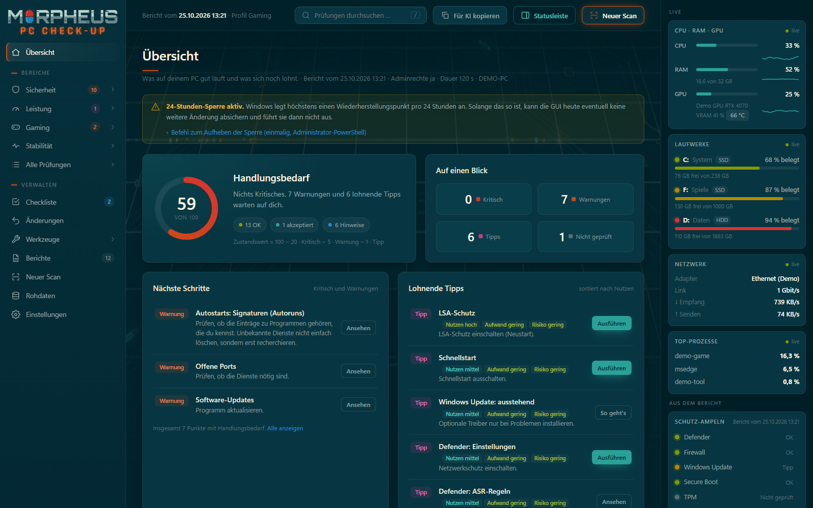
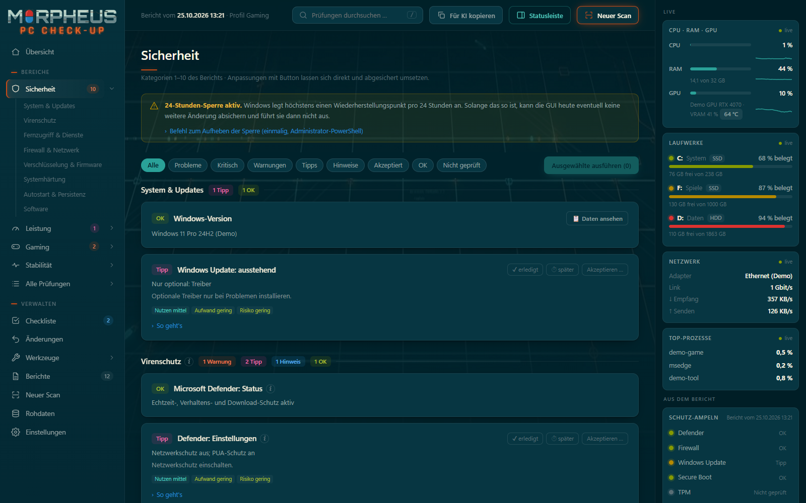
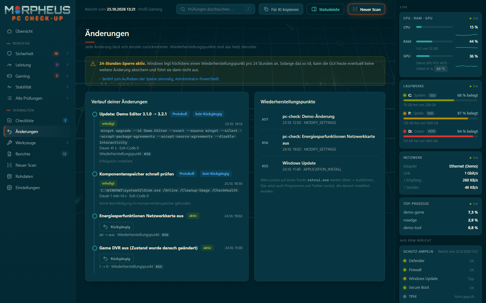
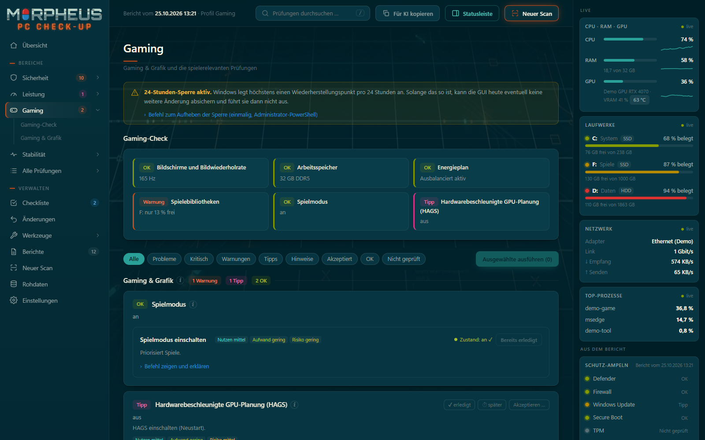
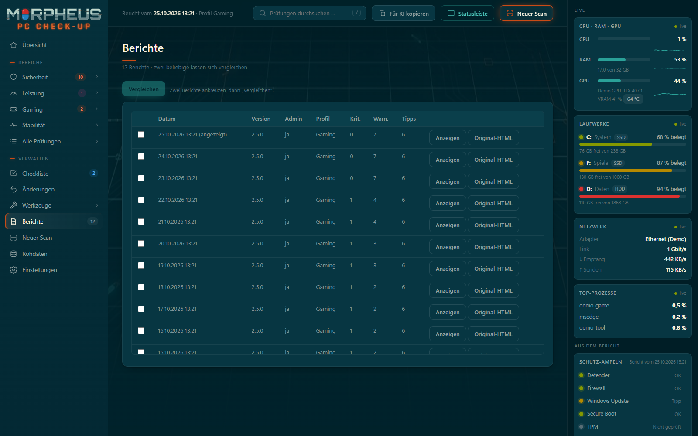
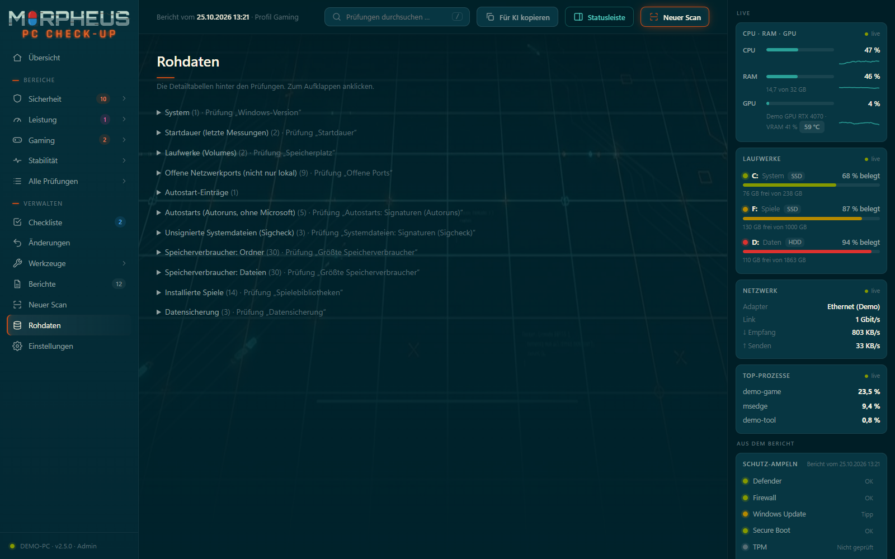
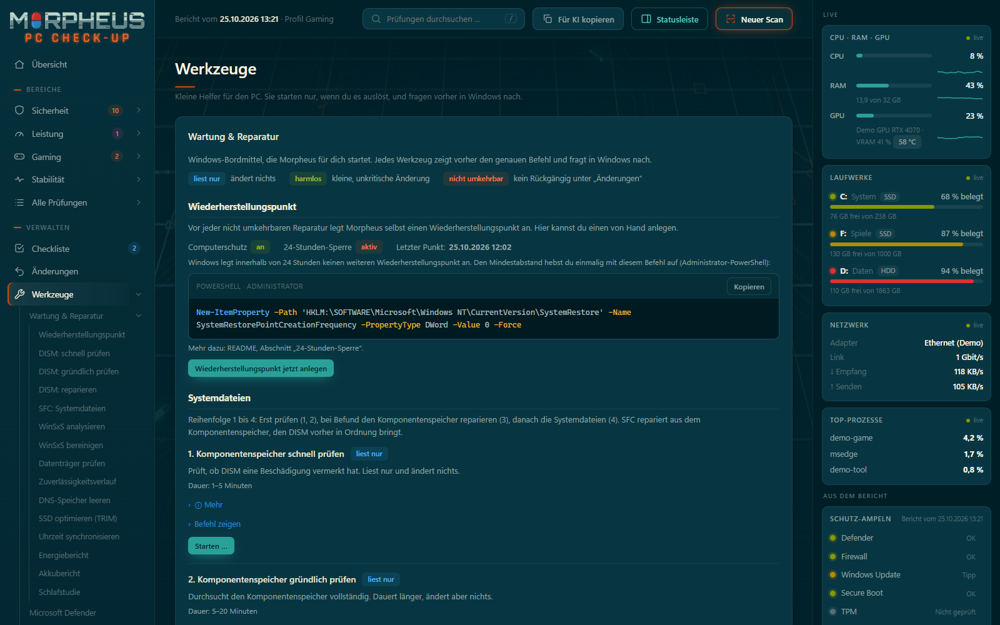

<p align="center">
  
</p>

# Morpheus – PC Check-up

Sicherheits- und Performance-Check für Windows-11-PCs mit Oberfläche. Die Prüfung liest nur. Empfehlungen lassen sich per Klick umsetzen, und jede Änderung ist durch einen Wiederherstellungspunkt abgesichert und einzeln rückgängig zu machen.

> **Hinweis:** Die Prüfung ändert nichts am System. Die Oberfläche (GUI) ändert Einstellungen nur nach einem Klick und einer Bestätigung. Vor jeder Änderung wird ein Wiederherstellungspunkt angelegt.



<table>
  <tr>
    <td align="center"><br><sub>Sicherheit</sub></td>
    <td align="center"><br><sub>Änderungen</sub></td>
  </tr>
  <tr>
    <td align="center"><br><sub>Gaming</sub></td>
    <td align="center"><br><sub>Berichte</sub></td>
  </tr>
  <tr>
    <td align="center"><br><sub>Rohdaten</sub></td>
    <td></td>
  </tr>
</table>


*Breites Layout auf WQHD. Screenshots mit Demodaten (Gerät „DEMO-PC“), keine echten Ergebnisse.*

## Schnellstart in 3 Schritten

1. **Herunterladen und entpacken.** Auf GitHub **Code → Download ZIP** wählen. Zuerst **Rechtsklick auf das ZIP → Eigenschaften → unten „Zulassen“ anhaken → OK**, sonst blockiert Windows die Dateien. Dann das ZIP entpacken, z. B. nach `Dokumente\morpheus-pc-checkup`.
2. **`pc-check-gui.cmd` doppelklicken** und die Adminabfrage (UAC) mit „Ja“ bestätigen. Beim ersten Start fragt Morpheus, ob es nach `C:\Program Files\Morpheus` installiert werden soll. **Enter = Ja.**
3. **Künftig über das Startmenü starten:** „Morpheus – PC Check-up“.

Zeigt Windows „Der Computer wurde durch Windows geschützt“: auf „Weitere Informationen“ → „Trotzdem ausführen“. Das erscheint bei Dateien ohne digitale Signatur.

**Warum installieren?** Die Oberfläche läuft mit Adminrechten. Deshalb muss der Code in einem Ordner liegen, den nur Administratoren ändern können. Ohne Installation, oder ohne Adminrechte, startet die GUI im **Nur-Lesen-Modus**: Anzeigen ja, Ändern und Scannen nein.

Git-Variante:

```bash
git clone https://github.com/oFAILIXo/morpheus-pc-checkup.git
```

Voraussetzungen: Windows 11 (Windows 10 funktioniert weitgehend), Windows PowerShell 5.1 (vorinstalliert), Microsoft Edge. Adminrechte werden empfohlen. winget (App-Installer) ist optional für die Update-Prüfung.

## Features

**Prüfen**
- **Rund 110 Prüfungen** zu Sicherheit und Leistung: Updates, Virenschutz, Firewall, Treiber, Autostart, Hardware, Energie, Stabilität, Datensicherung. Die Prüfung liest nur.
- **Speicherverbraucher:** die zehn größten Ordner, Dateien und Spiele je Laufwerk. Morpheus löscht nichts.
- **Sysinternals (optional):** Autoruns und Sigcheck prüfen Autostarts und Systemdateien auf Signaturen. Sie werden nur auf deinen Klick geladen.
- **Gaming-Check:** alle spielerelevanten Punkte auf einen Blick, z. B. Bildwiederholrate, HAGS, Spielebibliotheken und installierte Spiele.

**Verstehen**
- **Zustandswert 0–100:** wie gut der PC dasteht. Er ergibt sich aus den Befunden: 100 minus 20 je kritischem Befund, 5 je Warnung und 1 je Tipp.
- **Erklärungen und Klickwege:** Jede Prüfung hat ein i-Symbol mit Erklärung. „So geht's“ zeigt den Klickweg oder einen Befehl zum Kopieren.
- **„Für KI-Assistent kopieren“:** kopiert die Befunde **anonymisiert** (ohne PC-Name, Benutzer, IP- und MAC-Adressen, SIDs und E-Mail-Adressen) in die Zwischenablage. Den Text vor dem Einfügen trotzdem kurz durchlesen.

**Verbessern**
- **17 Anpassungen per Klick:** jede mit Bestätigungsdialog, Befehl zum Nachlesen und Erklärung.
- **Checkliste:** Punkte als „erledigt“ oder „später“ markieren. Der nächste Lauf zeigt, was wirklich behoben ist.
- **Wartung & Reparatur (ab 2.4):** DISM, SFC, Komponentenspeicher, chkdsk, DNS leeren, ReTrim, Zeit abgleichen, Energieberichte und Zuverlässigkeitsverlauf, mit festen Befehlen, Windows-Bestätigung und verständlicher Zusammenfassung.
- **Programme aktualisieren (ab 2.4):** winget-Updates in der Oberfläche mit Auswahl, Fortschritt und Ergebnis; im Konsolen-Scan weiter der Update-Dialog am Ende. Ab 2.5 läuft winget ohne Adminrechte; Installer mit Adminbedarf fragen selbst über Windows nach.

**Absichern**
- **Wiederherstellungspunkt vor jeder Änderung**, Rückgängig für jede Änderung einzeln.
- **Änderungsjournal** mit Verlauf aller Anpassungen.
- **Akzeptanzliste** für Befunde, die bewusst so gewollt sind. Ab 2.3.1 lassen sie sich direkt in der GUI akzeptieren und wieder zurücknehmen.
- **Defender-Werkzeuge:** Signaturen aktualisieren, Schnellscan, Offline-Scan.
- **24-Stunden-Sperre erkannt:** Die GUI zeigt ein Banner und erklärt, wie sie sich aufheben lässt. Unter Werkzeuge legst du einen Wiederherstellungspunkt auch von Hand an.
- **Datenordner reparieren (ab 2.4):** Haben Benutzerkonten zusätzliche Rechte auf den Datenordner bekommen (z. B. per „Fortsetzen“ im Explorer), bietet Morpheus die Reparatur an.

**Überwachen**
- **Live-Statusleiste:** CPU, RAM, GPU mit Temperatur, Laufwerke, Netzwerk und Top-Prozesse. Dazu die Schutz-Ampeln aus dem Bericht. Auf Wunsch ein- und ausblendbar.
- **Verlauf:** Probleme, Startdauer und freier Platz über die letzten Läufe.
- **Berichtsvergleich:** zwei beliebige Berichte nebeneinander. Geänderte Ergebnisse sowie neue (➕) und verschwundene (➖) Dienste, Treiber, Autostarts, Firewall-Regeln, Programme, Browser-Erweiterungen, Konten und offene Ports fallen auf.

## Bedienung

| Bereich | Inhalt |
|---|---|
| Übersicht | Zustandswert, nächste Schritte, lohnendste Tipps, Verlauf |
| Sicherheit | Befunde der Kategorien 1–10, je Befund mit passender Anpassung |
| Leistung | Hardware, Laufwerke und Speicherplatz, Energie, Auslastung. Ein Klick auf ein Laufwerk zeigt die zehn größten Ordner, Dateien und Spiele |
| Gaming | Gaming-Check und Gaming & Grafik |
| Stabilität | Abstürze, Hardwarefehler, Startdauer |
| Alle Prüfungen | alle Prüfungen nach Bereich und Kategorie |
| Checkliste | Punkte als „erledigt“ oder „später“ markieren |
| Änderungen | Journal mit „↶ Rückgängig“ und Liste der Wiederherstellungspunkte |
| Berichte | alle Läufe, Original-Bericht öffnen, zwei Berichte vergleichen |
| Neuer Scan | Optionen, Start, Live-Protokoll; danach öffnet sich der neue Bericht |
| Rohdaten | Detailtabellen hinter den Prüfungen |
| Einstellungen | Profil, Zeitraum und Akzeptanzliste (Regeln ansehen und zurücknehmen) |

**Menü (ab 2.5):** Jeder Bereich mit einem Pfeil `›` klappt seine Unterpunkte auf: Sicherheit, Leistung, Gaming und Stabilität ihre Kategorien, „Alle Prüfungen“ die Status-Filter, „Werkzeuge“ die Karten und unter „Wartung & Reparatur“ jedes einzelne Werkzeug. Ein Klick springt direkt dorthin. Ein Klick auf den Bereich selbst öffnet ihn und klappt ihn auf. Mit der Tastatur: Pfeil hoch/runter wechselt den Eintrag, Pfeil rechts klappt auf bzw. geht zum ersten Unterpunkt, Pfeil links klappt zu bzw. geht zurück zum Bereich, Enter öffnet.


| Werkzeuge | Wartung & Reparatur (Wiederherstellungspunkt anlegen, DISM, SFC, Komponentenspeicher, chkdsk, DNS, ReTrim, Zeit, Energieberichte, Zuverlässigkeitsverlauf); Defender-Signaturen aktualisieren, Schnellscan, Offline-Scan (mit Countdown, der PC startet neu); Programme aktualisieren (winget); eigene Spiele-Ordner; Sysinternals-Werkzeuge einrichten |

Die Suche liegt oben. Mit der Taste `/` springst du direkt dorthin.

**Anpassung ausführen:** Die Karte bei einem Befund zeigt die Anpassung. „▸ Befehl zeigen und erklären“ zeigt den PowerShell-Befehl samt Erklärung. Dann „Ausführen“, im Dialog bestätigen und zum Schluss im Windows-Fenster „Morpheus – Änderung bestätigen“ auf „Ja“ klicken. Mehrere Anpassungen lassen sich gemeinsam ausführen. Ist das Ziel schon erreicht, steht dort „Bereits erledigt“. Mit „Daten ansehen“ springst du von einer Prüfung zur passenden Detailtabelle im Anhang.

**Anpassung zurücknehmen:** Im Bereich **Änderungen** den Eintrag mit „↶ Rückgängig“ wählen. Hat sich der Zustand inzwischen anders geändert, fragt die GUI nach.

**Berichte vergleichen:** Im Bereich **Berichte** zwei Zeilen ankreuzen und „Vergleichen“ wählen. Mit „Original-HTML“ öffnest du den unveränderten Bericht.

**Speicher-Fenster:** Fährst du mit der Maus über ein Laufwerk der Karte „Laufwerke“ (oder klickst es an), zeigt ein Fenster die zehn größten Ordner, Dateien und Spiele. Grundlage ist der Stand aus dem letzten Scan oder aus „Neu berechnen“; das Datum steht im Fenster. Ein Klick auf einen Eintrag kopiert den Pfad. Morpheus löscht nichts. Systemdateien wie `pagefile.sys` sind mit „Windows“ gekennzeichnet.

**Defender-Werkzeuge:** Im Bereich **Werkzeuge** aktualisierst du die Defender-Signaturen, startest einen Schnellscan oder einen Offline-Scan. Der Offline-Scan braucht eine doppelte Bestätigung und einen 15-Sekunden-Countdown, danach startet der PC neu. Zusätzlich gibt es einen Knopf direkt am Defender-Befund.

**Neuer Scan:** Im Bereich **Neuer Scan** die Optionen wählen und starten. Das Live-Protokoll zeigt den Fortschritt. Danach öffnet sich der neue Bericht.

**Den Bericht lesen:** Status je Prüfung: **Kritisch**, **Warnung**, **Tipp**, **Akzeptiert**, **Hinweis**, **OK**, **Nicht geprüft**. Ein Klick auf eine Zahl bei der Ampel filtert nach diesem Status. Tipps sind nach Nutzen im Verhältnis zu Aufwand und Risiko sortiert. Reine Informationen bleiben „Hinweis“.

## Anpassungen per Klick

Die Karten mit einer Anpassung erscheinen direkt beim passenden Befund.

| Bereich | Anpassung | Neustart nötig |
|---|---|---|
| Sicherheit | Defender-Netzwerkschutz an | Nein |
| Sicherheit | Schutz vor potenziell unerwünschten Apps an | Nein |
| Sicherheit | ASR-Regeln für anfällige Treiber und LSASS-Diebstahl: blockieren oder nur protokollieren | Nein |
| Sicherheit | Remoteunterstützung aus | Nein |
| Sicherheit | Remotedesktop aus | Nein |
| Sicherheit | LLMNR aus | Nein |
| Sicherheit | Computerschutz (Wiederherstellungspunkte) einschalten | Nein |
| Sicherheit | Speicher für Wiederherstellungspunkte auf 10 % vergrößern | Nein |
| Leistung | Schnellstart aus | Nein |
| Sicherheit | LSA-Schutz an | Ja |
| Sicherheit | Sperrliste anfälliger Treiber an | Ja |
| Leistung | PCIe-Energieverwaltung (ASPM) aus | Nein |
| Gaming | Spielmodus an | Nein |
| Gaming | Hardwarebeschleunigte GPU-Planung an | Ja |
| Gaming | Hintergrundaufnahme (Game DVR) aus | Nein |
| Gaming | Mausbeschleunigung aus (wirkt nach Ab- und Anmelden) | Nein |
| Gaming | Energiesparfunktionen der Netzwerkkarte aus (Verbindung ist kurz weg) | Nein |

Neu gestartet wird nie automatisch. Bei Anpassungen mit Neustart zeigt die GUI einen Hinweis.

**Nicht per Klick:** BIOS, Secure Boot, BitLocker, Treiber, Löschen, Konten und Firewall-Regeln gibt es nur als Anleitung. Sie lassen sich nicht sauber zurücknehmen.

## Absicherung von Änderungen

Jede Anpassung läuft in festen Schritten:

1. Aktuellen Zustand lesen.
2. Voraussetzungen prüfen.
3. Wiederherstellungspunkt anlegen und prüfen. Fehlt er, wird nichts geändert.
4. Eintrag im Änderungsjournal schreiben.
5. Änderung ausführen.
6. Kontrolle. Klappt sie nicht, wird sofort zurückgesetzt.

**Rückgängig:** Jede Änderung lässt sich einzeln zurücknehmen und bekommt dafür einen eigenen Wiederherstellungspunkt. Rückgängig stellt exakt den alten Zustand her, auch wenn ein Wert vorher nicht existierte.

**Alles zurück:** `rstrui.exe` startet die Systemwiederherstellung. Sie setzt auch Programme und Treiber zurück, die danach installiert wurden.

### 24-Stunden-Sperre

Windows legt standardmäßig höchstens einen Wiederherstellungspunkt pro 24 Stunden an. Die GUI zeigt dann ein Banner und lehnt Änderungen ab, für die kein neuer Punkt entsteht.

Die Sperre lässt sich einmalig in einer Administrator-PowerShell aufheben:

```powershell
New-ItemProperty -Path 'HKLM:\SOFTWARE\Microsoft\Windows NT\CurrentVersion\SystemRestore' -Name SystemRestorePointCreationFrequency -PropertyType DWord -Value 0 -Force
```

Rückgängig machen:

```powershell
Remove-ItemProperty -Path 'HKLM:\SOFTWARE\Microsoft\Windows NT\CurrentVersion\SystemRestore' -Name SystemRestorePointCreationFrequency
```

Die GUI ändert diese Einstellung bewusst nicht selbst.

**Ausnahme:** „Computerschutz einschalten“ läuft ohne Wiederherstellungspunkt, weil vorher keiner entstehen kann. Achtung: Dessen Rückgängig schaltet den Schutz aus und löscht alle Wiederherstellungspunkte.

## Sicherheit der GUI

Die GUI läuft mit Adminrechten. Deshalb gelten strenge Regeln:

- Der Server hört nur auf `127.0.0.1`.
- Edge bekommt nur einen Einmal-Code. Die Oberfläche tauscht ihn gegen das Sitzungstoken. Das Token steht nie in einer Befehlszeile oder Adresse.
- Host und Herkunft jeder Anfrage werden geprüft.
- Die Oberfläche kann nur feste Aktionen aus dem Katalog auslösen, keine beliebigen Befehle.
- Original-Berichte laufen im abgeschotteten Rahmen mit einmaliger Lesemarke.
- Der Code liegt unter `C:\Program Files\Morpheus`, die Daten unter `C:\ProgramData\Morpheus`. Beides können nur Administratoren ändern.
- Auch was Morpheus nachlädt, kommt nur aus Ordnern, die nur Administratoren ändern können (ab 2.3.3): PowerShell-Module nur aus `C:\Windows\System32` und `C:\Program Files`, Windows-Programme mit vollem Pfad, winget nur aus dem signierten App-Installationsprogramm, temporäre Dateien unter `C:\ProgramData\Morpheus\temp`.
- Vor jeder Änderung wird ein Wiederherstellungspunkt geprüft. Jede Änderung lässt sich einzeln zurücknehmen.
- Wartungswerkzeuge und Programm-Updates (ab 2.4) laufen nur aus einem festen Katalog mit festen Programmpfaden (System32 bzw. signiertes winget-Paket). Die Oberfläche schickt nur eine Werkzeug-Id, ein Laufwerk aus der vom Server ermittelten Liste oder Paket-Ids aus der zuletzt vom Server gesuchten Liste.
- **Jede Änderung und jedes Rückgängig bestätigt zusätzlich ein Windows-Dialog** („Morpheus – Änderung bestätigen“). Er gehört zum Prozess mit Adminrechten; Windows verhindert, dass Programme ohne Adminrechte darin klicken oder tippen. So kann auch ein Schadprogramm, das das Morpheus-Fenster fernsteuert, nichts ändern. „Nein“ ist vorbelegt.
- Die Daten unter `C:\ProgramData\Morpheus` können nur Administratoren lesen und ändern. Berichte enthalten Programme, Konten und Netzwerkdetails; auch andere Benutzerkonten des PCs sehen sie nicht. Ansehen kannst du sie in Morpheus unter „Berichte“.
- **Den Ordner `C:\ProgramData\Morpheus` nicht im Explorer über „Fortsetzen“ öffnen.** Der Explorer trägt dabei dauerhaft Vollzugriff für dein Konto ein. Dann könnte jedes Programm, das unter deinem Konto läuft, Journal, Akzeptanzliste und Zwischendateien ändern. Morpheus erkennt das beim nächsten Start und benutzt den Ordner nicht mehr. Zum Ansehen eine PowerShell als Administrator öffnen, z. B. `Get-ChildItem C:\ProgramData\Morpheus\reports`. Ist es schon passiert: zusätzliche Rechte in einer Admin-PowerShell entfernen. Ab 2.4 bietet Morpheus dann beim Start an, die Rechte selbst zu reparieren (Banner „Die Rechte des Datenordners wurden geändert“, Knopf „Rechte reparieren …“, nach Windows-Bestätigung). Danach Morpheus neu starten und unter „Änderungen“ sowie „Einstellungen > Akzeptanzliste“ prüfen, ob alle Einträge von dir stammen.
  ```powershell
  icacls C:\ProgramData\Morpheus /remove:g "*$([Security.Principal.WindowsIdentity]::GetCurrent().User.Value)" /T /C
  ```
- Änderungen sind nur per POST mit JSON möglich.
- Der Server endet mit dem Fenster. Läuft noch ein Werkzeug, wartet er, bis es fertig ist.

### Datenordner reparieren (ab 2.4)

- **Wann:** Nur wenn Benutzerkonten zusätzliche Rechte auf `C:\ProgramData\Morpheus` haben. Bei fremdem Besitzer oder Verknüpfungen im Ordner legt Morpheus den Ordner weiterhin beiseite.
- **Was passiert:** Morpheus entfernt die zusätzlichen Rechte (nach Windows-Bestätigung). `temp` und `tools` werden neu angelegt, `tools` wird bei Bedarf neu geladen (Sysinternals).
- Journal, Akzeptanzliste und Checkliste bleiben erhalten und werden neu geschrieben. Berichte bleiben unverändert.
- **Stattdessen neu anlegen:** Der alte Ordner wird als `Morpheus.unsicher-<Datum>` beiseitegelegt, danach entsteht ein leerer Ordner.
- **Rückgängig:** Für ältere Journal-Einträge gibt es das nur mit einer Zusatzbestätigung. Prüfe vorher, ob du die Änderung selbst vorgenommen hast.
- Danach Morpheus neu starten.

## Wo liegen meine Daten?

| Was | Installierte Fassung | Ohne Installation (Nur-Lesen) |
|---|---|---|
| Programm | `C:\Program Files\Morpheus` | Ordner, aus dem du startest |
| Berichte | `C:\ProgramData\Morpheus\reports\` | Ordner `reports\` neben dem Script |
| Änderungsjournal | `C:\ProgramData\Morpheus\changes\journal.json` | wie links, Ändern gesperrt |
| Checkliste | `C:\ProgramData\Morpheus\state\checklist.json` | wie links |
| Akzeptanzliste | `C:\ProgramData\Morpheus\accepted.psd1` | wie links |
| Sysinternals-Werkzeuge | `C:\ProgramData\Morpheus\tools` | nicht verfügbar |
| Eigene Spiele-Ordner | `C:\ProgramData\Morpheus\state\spielordner.json` | wie links |
| Protokoll | `C:\ProgramData\Morpheus\state\gui.log` | wie links |

Den Ordner können nur Administratoren lesen und ändern; Berichte siehst du in Morpheus unter „Berichte“. Vorhandene Berichte und die `accepted.psd1` übernimmt die Installation einmalig. Die Akzeptanzliste bearbeitest du nach der Installation als Administrator in `C:\ProgramData\Morpheus\accepted.psd1`.

## Nur Scan (ohne Oberfläche)

Gibt es eine aktuelle Installation unter `C:\Program Files\Morpheus`, startet `pc-check.cmd` den Scan aus dieser installierten Fassung. So bekommt Code aus einem Ordner, den auch Programme ohne Adminrechte ändern können, keine Adminrechte.

1. **Doppelklick auf `pc-check.cmd`** und die Adminabfrage (UAC) mit „Ja“ bestätigen.
   Zeigt Windows „Der Computer wurde durch Windows geschützt“: **Weitere Informationen → Trotzdem ausführen**.
2. Der Lauf dauert etwa 4–6 Minuten.
3. Am Ende fragt das Script, ob verfügbare Programm-Updates installiert werden sollen (`1,3`, `a` für alle, **Enter für keine**).
4. Der **Bericht öffnet sich automatisch im Browser**. Er liegt im Unterordner `reports\` als `pc-check_<Datum>.html`, zusätzlich als `.md` (Text) und `.json` (für den Vergleich mit dem nächsten Lauf).

Alternativ in einer **Administrator-PowerShell** im Ordner:

```powershell
powershell.exe -NoProfile -ExecutionPolicy Bypass -File .\pc-check.ps1
```

`-ExecutionPolicy Bypass` gilt nur für diesen Aufruf und ändert keine Einstellung. Ohne Adminrechte läuft das Script auch, lässt aber einige Prüfungen aus (BitLocker, TPM, Sicherheitsprotokoll …).

Die Dateien heißen aus Kompatibilitätsgründen weiterhin `pc-check.*`.

| Parameter | Bedeutung |
|---|---|
| `-EventDays 30` | Ereignisprotokolle der letzten 30 statt 14 Tage auswerten (1–90) |
| `-OutputDir <Pfad>` | Bericht woanders ablegen |
| `-SkipUpdateSearch` | keine Online-Suche nach ausstehenden Windows-Updates |
| `-SkipWinget` | keine Prüfung auf Software-Updates per winget |
| `-SkipSpeicher` | keine Auswertung der größten Speicherverbraucher (spart 1–3 Minuten) |
| `-SkipSysinternals` | Autoruns und Sigcheck nicht verwenden |
| `-SpielOrdnerFile <Pfad>` | Datei mit eigenen Spiele-Ordnern (Standard: `state\spielordner.json` im Datenordner) |
| `-NoUpdatePrompt` | keine Nachfrage nach Programm-Updates am Ende (rein lesender Lauf) |
| `-CompareWith <Pfad>` | mit diesem Bericht vergleichen statt mit dem jüngsten in `reports\` |
| `-AcceptedFile <Pfad>` | andere Akzeptanzliste verwenden |
| `-NoOpen` | HTML-Bericht am Ende nicht automatisch im Browser öffnen |
| `-Profil Gaming` | Empfehlungen für `Gaming`, `Office` oder `Laptop` gewichten (Standard: automatisch, Laptop bei Akku, Gaming bei eigener Grafikkarte) |

## Bewusst gewollte Befunde (`accepted.psd1`)

Manches ist auf deinem PC absichtlich so, z. B. ein genutztes Fernwartungsprogramm. Damit es nicht bei jedem Lauf als Warnung erscheint:

- **In der GUI (ab 2.3.1):**
  - Am Befund „Akzeptieren …“ wählen und eine Begründung eingeben, optional ein Ablaufdatum. Die Regel gilt genau für den aktuellen Befund-Text.
  - Unsignierte Systemdateien (Sigcheck) akzeptierst du einzeln unter „Daten ansehen“. Die Regel ist an den SHA256 der Datei gebunden: Ändert sich die Datei, kommt die Warnung zurück.
  - Gespeichert wird erst nach dem Windows-Bestätigungsdialog.
  - Unter Einstellungen > Akzeptanzliste nimmst du Regeln wieder zurück.
  - Es wirkt ab dem nächsten Scan.
- **Von Hand:**
  1. `accepted.example.psd1` nach `accepted.psd1` kopieren (installiert: `C:\ProgramData\Morpheus`).
  2. Einträge nach dem Beispiel ergänzen; den Befund-Text aus dem eigenen Bericht übernehmen.
  - Schreibt die GUI die Datei, bleiben deine Regeln erhalten, Kommentare aber nicht. Die vorige Fassung liegt dann als `accepted.psd1.bak` daneben.

Passende Befunde erscheinen dann als „Akzeptiert“ und zählen nicht in den Zustandswert. Ein enges Muster (`Match`) sorgt dafür, dass die Warnung zurückkehrt, sobald sich etwas ändert. Mit `Until` meldet sich ein Punkt nach einem Datum wieder. `accepted.psd1` ist per `.gitignore` vom Repo ausgeschlossen.

## Wartung & Reparatur (ab 2.4)

Unter **Werkzeuge > Wartung & Reparatur** startet Morpheus Windows-eigene Werkzeuge mit festen Befehlen. Jedes Werkzeug zeigt den genauen Befehl, läuft im Hintergrund mit Live-Ausgabe und fragt vorher im Windows-Dialog nach. Es gibt drei Klassen:

| Klasse | Bedeutung | Werkzeuge |
|---|---|---|
| liest nur | ändert nichts | DISM `/CheckHealth`, `/ScanHealth`, `/AnalyzeComponentStore`; `chkdsk C: /scan` (Laufwerk wählbar); `powercfg /energy`, `/batteryreport`, `/sleepstudy` |
| harmlos | kleine Wartung ohne Risiko | Wiederherstellungspunkt anlegen; `ipconfig /flushdns`; ReTrim für SSDs (`defrag C: /L`, dasselbe wie `Optimize-Volume -ReTrim`); `w32tm /resync` |
| nicht umkehrbar | Reparatur bzw. Bereinigung | DISM `/RestoreHealth` (braucht Internet), `sfc /scannow`, DISM `/StartComponentCleanup` |

- **Nicht umkehrbar heißt:** Unter „Änderungen“ gibt es dafür kein „Rückgängig“. Vorher legt Morpheus automatisch einen Wiederherstellungspunkt an und prüft ihn. Klappt das nicht (z. B. 24-Stunden-Sperre), startet nichts. Erst nach einer ausdrücklichen Zusatzbestätigung geht es ohne Punkt weiter; der Windows-Dialog sagt das dann deutlich.
- **Reihenfolge bei Systemdateien:** 1. CheckHealth, 2. ScanHealth, 3. RestoreHealth, 4. `sfc /scannow`. SFC repariert aus dem Komponentenspeicher, den DISM vorher in Ordnung bringt.
- **Komponentenspeicher:** Morpheus verwendet kein `/ResetBase` (das macht installierte Updates dauerhaft). Den Ordner `WinSxS` nie von Hand löschen.
- **Abbrechen** geht bei lesenden Werkzeugen, chkdsk, ReTrim und dem Energiebericht. DISM-Reparatur, Bereinigung und SFC sollte man nicht unterbrechen; dort gibt es keinen Abbruch-Knopf.
- **Ergebnis:** Morpheus fasst die Ausgabe verständlich zusammen (deutsche und englische Windows-Ausgaben) und schreibt ein Protokoll mit Befehl, Dauer, Exit-Code und Kurzfassung ins Änderungsjournal.
- **Energieberichte** landen in `C:\ProgramData\Morpheus\reports` und öffnen sich in Morpheus im abgeschotteten Rahmen.
- **Zuverlässigkeitsverlauf** (`perfmon /rel`) öffnet sich ohne Adminrechte. Klappt das nicht: `Win + R`, `perfmon /rel`.
- Bewusst nicht dabei (erst später bzw. nur als Anleitung): `chkdsk /f`, Speichertest, Windows Update zurücksetzen, alte Treiber entfernen, Netzwerk-Reset.

## Programme aktualisieren (ab 2.4)

Unter **Werkzeuge > Programme aktualisieren** sucht Morpheus mit winget nach Updates, du wählst die Programme aus, und Morpheus installiert sie mit Fortschritt und Ergebnis je Programm.

- Vorher entsteht ein Wiederherstellungspunkt. **Programm-Updates lassen sich nicht über „Änderungen“ zurücknehmen**; im Journal steht je Programm ein Protokoll.
- Angeboten werden nur Programme aus der zuletzt in Morpheus gesuchten Liste (gleiche Regeln wie im Konsolendialog unten).
- „Abbrechen“ hört nach dem gerade laufenden Programm auf.
- **winget läuft ohne Adminrechte (ab 2.5),** bei der Suche und bei den Updates. Morpheus startet winget über eine kurzlebige geplante Aufgabe unter deinem Konto, aber mit dem normalen Benutzer-Token (wie ein Programm aus dem Startmenü). Die Aufgabe wird nach jedem Programm wieder gelöscht. Braucht ein Installer Adminrechte, fragt Windows selbst nach (Benutzerkontensteuerung). **Dort den Herausgeber prüfen**: Steht „Unbekannt“ oder ein unerwarteter Name da, „Nein“ wählen. Je Programm kann also eine Windows-Abfrage erscheinen. Lehnst du sie ab, meldet Morpheus das Programm als „nicht aktualisiert“.
- **Behoben in 2.5:** Bis 2.4.0 lief winget mit Adminrechten. winget legt heruntergeladene Installer in einem Ordner ab, den es deinem Konto freigibt; ein Programm, das schon unter deinem Konto läuft, hätte einen Installer kurz vor dem Start austauschen können, der dann mit Adminrechten gelaufen wäre (bekanntes Restrisiko von 2.4.0). Jetzt bekommt ein ausgetauschter Installer keine Adminrechte mehr ohne sichtbare Windows-Abfrage.
- Morpheus startet winget nur aus dem signierten App-Installer-Paket unter `C:\Program Files\WindowsApps`, nie über den Suchpfad (der App-Alias im Benutzerprofil wäre von Programmen ohne Adminrechte austauschbar). Das gilt ab 2.4 auch für den Scan.

## Sysinternals-Werkzeuge (ab 2.3)

Morpheus kann zwei kostenlose Werkzeuge von Microsoft Sysinternals nutzen: **Autoruns** (alle Autostarts: Dienste, Treiber, geplante Aufgaben, Anmeldung, Explorer) und **Sigcheck** (Signaturen der Dateien in `System32` und `System32\drivers`). Sie sind nicht enthalten, sondern werden nur auf deinen Klick geladen:

1. Morpheus > **Werkzeuge** > Karte „Sysinternals (Microsoft)“ > **Herunterladen …**
2. Lizenzbedingungen lesen (Link) und das Häkchen setzen. Die Zustimmung wird gespeichert.
3. Im Windows-Dialog bestätigen.

- **Quelle:** nur `https://download.sysinternals.com/files/Autoruns.zip` und `Sigcheck.zip` (zusammen ca. 4 MB). Das ist die einzige Verbindung. Einen VirusTotal-Abgleich gibt es nicht, es verlassen also keine Daten den PC.
- **Ablage:** `C:\ProgramData\Morpheus\tools` (nur Administratoren). Entpackt werden nur `autorunsc64.exe`, `sigcheck64.exe` und der Lizenztext.
- **Vor jedem Start** prüft Morpheus: Ordner und Datei nur für Administratoren änderbar, Datei unverändert seit dem Download (SHA256), gültige Signatur von Microsoft Corporation mit Microsoft-Stammzertifikat, Versionsinfo „Sysinternals“. Während des Laufs ist die Datei gegen Austausch gesperrt. Schlägt eine Prüfung fehl, startet das Werkzeug nicht, und der Scan meldet es.
- **Im Scan:** neue Prüfungen „Autostarts: Signaturen (Autoruns)“, „Autostarts: beschreibbare Pfade (Autoruns)“ und „Systemdateien: Signaturen (Sigcheck)“, je mit Tabelle unter „Daten ansehen“. Ohne eingerichtete Werkzeuge oder ohne Adminrechte werden sie übersprungen. Abschalten mit `-SkipSysinternals` bzw. dem Häkchen unter „Neuer Scan“.
- **Prüfhilfe:** Bei unsignierten Systemdateien gibt es je Datei „Mit Defender prüfen“, einen VirusTotal-Link und „Hash kopieren“.
- **Entfernen:** Werkzeuge > „Entfernen …“ löscht die Dateien und nimmt die Zustimmung zurück.

## Update-Dialog am Ende

Gilt für den reinen Scan in der Konsole (`pc-check.cmd`); in der GUI geht das unter Werkzeuge > Programme aktualisieren. Nach dem fertigen Bericht listet das Script verfügbare **Programm**-Updates nummeriert auf und fragt, welche installiert werden sollen (`1,3`, `a` für alle, Enter für keine).

- winget lädt die Updates aus den Herstellerquellen und **akzeptiert dabei die Lizenzbedingungen der Pakete**.
- Nicht angeboten werden Spiele und Launcher, Programme mit eigener Update-Funktion (Edge, Teams, Outlook, VS Code, Autodesk Fusion) und Einträge, die winget kennt, Windows aber nicht mehr als installiert führt.
- winget läuft auch hier ohne Adminrechte (ab 2.5, siehe oben); die Ausgabe erscheint in der Konsole, Installer mit Adminbedarf fragen selbst über Windows nach.
- Bricht ein Installer ab, weil das Programm noch läuft, bietet der Dialog nach dem Schließen einen zweiten Versuch an.
- Das Ergebnis wird als Abschnitt „Updates nach dem Lauf“ an den Bericht angehängt.

## Start aus einer Store-App

Store-Apps (MSIX) virtualisieren Teile der Registry (`HKCU`) für alle Prozesse, die sie starten, auch mit Adminrechten. Wird Morpheus aus so einer App heraus gestartet, können Ergebnisse unter `HKCU` abweichen. Die Prüfung „Ausführungsumgebung“ warnt dann. Am besten per Doppelklick auf `pc-check-gui.cmd` oder `pc-check.cmd` bzw. aus einem normalen PowerShell-Fenster starten.

## Datenschutz

- Alles läuft **lokal**. Es werden keine Daten an den Autor oder Dritte geschickt.
- Netzwerkzugriffe gibt es nur für die Windows-Update-Suche, winget und die UPnP-Abfrage am eigenen Router, sowie auf deinen Klick für Sysinternals, DISM `/RestoreHealth` (Windows Update) und den Zeitabgleich (`w32tm /resync`).
- Der Bericht enthält viele Details deines PCs (Programme, Konten, Netzwerk, Treiber). Er bleibt lokal und ist per `.gitignore` ausgeschlossen. **Nicht unbedacht weitergeben oder hochladen.** Für Fragen an eine KI die anonymisierte Kopierfunktion nutzen und den Text vorher kurz durchlesen.

## Was geprüft wird

**Sicherheit:** Windows-Version und Updates, Defender (Status, Einstellungen, ASR-Regeln, Ausnahmen, Funde), Firewall und offene Ports, UPnP-Weiterleitungen am Router, SMB/Freigaben, Konten und Kennwortrichtlinie, UAC, Kernisolierung/Speicherintegrität, LSA-Schutz, Treiber-Sperrliste, Exploit-Schutz, Spectre-Tweaks, Secure Boot (inkl. 2023er-Zertifikate), TPM, BitLocker, BIOS, Datensicherung (Dateiversionsverlauf, OneDrive-Ordnersicherung, Systemabbild), Fernzugriff (RDP, Fernwartungstools), Drittanbieter-Dienste und -Treiber (inkl. bekannt anfälliger Treiber), Dienstpfade, Autostart (mit Sysinternals Autoruns zusätzlich alle Autostart-Orte, Signaturen und beschreibbare Pfade), unsignierte Systemdateien (Sysinternals Sigcheck), geplante Aufgaben, WMI-Persistenz, Browser-Erweiterungen, veraltete Software, sicherheitsrelevante Ereignisse.

**Performance:** CPU, RAM (XMP, Dual-Channel), GPU-Treiber, Bildwiederholrate der Monitore, Laufwerke (Typ, Zustand, Platz, TRIM), größte Speicherverbraucher je Laufwerk, Auslagerungsdatei, Energieplan, Gaming-Einstellungen (Spielmodus, HAGS, Game DVR, Overlays), Resizable BAR und PCIe-Anbindung (NVIDIA), Spielebibliotheken (Laufwerk und Platz), installierte Spiele (Steam, Epic, GOG, EA, Ubisoft, Xbox), Energiesparfunktionen der Netzwerkkarte, Grundlast, Autostart-Umfang, Netzwerk, Stabilität (Hardwarefehler, Bluescreens, Grafiktreiber-Abstürze, Drosselung, Programmabstürze, Startdauer).

## Nebenwirkungen (nicht am System)

- `secedit` exportiert die Sicherheitsrichtlinie in eine Temp-Datei, die sofort gelöscht wird.
- `Add-Type` kompiliert eine kleine Hilfsklasse zum Auslesen der Bildwiederholraten.
- Windows-Update-Suche, winget und die UPnP-Abfrage gehen ins Netz bzw. zum Router. Der Scan selbst lädt nichts von Sysinternals; das geschieht nur per Klick in der GUI.
- Autoruns und Sigcheck (falls eingerichtet) laufen je 1–3 Minuten. Sie merken sich die angenommene Lizenz in der Registry des angemeldeten Benutzers (`HKCU\Software\Sysinternals`).
- Die Speicherauswertung zählt alle Dateien der festen Laufwerke (nur Namen und Größen, keine Inhalte), folgt keinen Verknüpfungen oder Junctions und dauert je nach Laufwerken 1–3 Minuten.
- Nur der Update-Dialog bzw. „Programme aktualisieren“ installiert etwas, und nur, was du ausdrücklich auswählst. Reparaturen unter „Wartung & Reparatur“ laufen nur auf deinen Klick nach Windows-Bestätigung.

## Entwicklung

- **Mock-Modus** ohne Adminrechte und ohne echten Scan: Im Ordner `gui` einen Server starten, z. B. `python -m http.server 8791 --bind 127.0.0.1`, und `http://127.0.0.1:8791/dev/mock.html` öffnen. Die Routen sind Hash-Adressen, z. B. `#/uebersicht`, `#/sicherheit`, `#/aenderungen`, `#/gaming`, `#/berichte`, `#/rohdaten`. Mit `?nav=sicherheit,werkzeuge` vor dem `#` klappt der Mock diese Menüpunkte auf, `?latenz=1500` simuliert einen langsamen Server. Die Screenshots in `docs\screenshots\` entstehen so mit Demodaten.
- **Tests** mit Pester 3.4, das in Windows enthalten ist. Aufruf im Projektordner: `Invoke-Pester .\tests`. Die Tests ändern nichts am System. Wiederherstellungspunkte und Aktionen werden nur gelesen bzw. mit Attrappen geprüft.
- **Aktionskatalog:** Neue Aktionen in `pc-check.aktionen.ps1` brauchen Lesen, Ausführen, Rückgängig und einen Eintrag in `tests/Aktionen.Tests.ps1`.
- Aufbau und Sicherheitsmodell der GUI: `docs/gui-architektur.md`.

## Versionen

- **2.5.0:** Aufklappbares Menü links: Bereiche zeigen ihre Kategorien, „Alle Prüfungen“ die Filter, „Werkzeuge“ die Karten und jedes Wartungswerkzeug; ein Klick springt direkt dorthin, bedienbar per Tastatur. **Sicherheit:** winget läuft nur noch ohne Adminrechte, bei der Suche und bei den Updates, im Update-Dialog der GUI und am Ende des Konsolen-Scans. Installer, die Adminrechte brauchen, fragen selbst über Windows nach, mit sichtbarem Herausgeber. Damit ist das in 2.4.0 genannte Restrisiko (ausgetauschter Installer im Temp-Ordner von winget) behoben. Die Zeile „WinGet-Ordner“ aus 2.4 entfällt.
  - **Behoben:** Der Speicher für Wiederherstellungspunkte fiel auf 2 % zurück (auch in 2.4.0). Unter Windows 11 mit „Point-in-time restore“ setzt Windows die Grenze bei jedem Start auf dessen Einstellung zurück; die Anpassung „Speicher auf 10 % vergrößern“ wirkte nur bis zum Neustart. Morpheus erkennt das jetzt und nennt den dauerhaften Weg: Einstellungen › System › Wiederherstellung › Point-in-time restore › Regler auf etwa 10 %.
- **2.4.0:** Werkzeuge > Wartung & Reparatur: neue Klasse „nicht umkehrbare Aktion“ mit festem Befehlskatalog, Windows-Bestätigung, Hintergrund-Job mit Live-Ausgabe und Abbruch, geprüftem Wiederherstellungspunkt vor Reparaturen und Protokoll im Journal; Knopf „Wiederherstellungspunkt jetzt anlegen“; DISM (CheckHealth, ScanHealth, RestoreHealth, AnalyzeComponentStore, StartComponentCleanup) und `sfc /scannow` mit verständlicher Zusammenfassung; `chkdsk /scan`, DNS leeren, ReTrim, Zeit abgleichen, Energieberichte, Zuverlässigkeitsverlauf. Werkzeuge > Programme aktualisieren (winget) mit Auswahl, Fortschritt und Ergebnis. winget nur noch aus dem signierten App-Installer-Paket (auch im Scan). Datenordner-Rechte in der GUI reparieren statt beiseitelegen (#63).
  - **Behoben:** Die Verbindung zur GUI brach ab, wenn das Morpheus-Fenster 1–2 Minuten im Hintergrund lag (Edge drosselt dann die Seite, der Server wertete das als geschlossenes Fenster). Betroffen waren alle Versionen seit 2.1. Jetzt gilt das Ende der Edge-Prozesse mit dem Morpheus-Profil als Signal; das Lebenszeichen der Seite ist nur noch Rückfall (10 Minuten), und Edge startet ohne Drosselung des Hintergrundfensters.
- **2.3.3:** Sicherheits-Hotfix gegen Rechteausweitung. Morpheus fand winget und PowerShell-Module bisher auch in Ordnern, die Programme ohne Adminrechte beschreiben können, und hätte dort abgelegte Fälschungen mit Adminrechten gestartet. Jetzt gilt: winget nur aus dem signierten App-Installationsprogramm (sonst wird die Prüfung übersprungen), Module nur aus System32 und Program Files, alle Windows-Programme mit vollem Pfad, temporäre Dateien im gesicherten Datenordner, kein Standardbrowser mit Adminrechten. Ein neuer Test hält das für künftige Erweiterungen fest.
- **2.3.2:** Prüfung „Wiederherstellung“ unterscheidet „Computerschutz aus“ und „Speicher zu klein“ (zeigt die Grenze und von Windows gelöschte Punkte); neue Anpassung „Speicher für Wiederherstellungspunkte vergrößern“; Warnung, wenn der Speicher zu klein ist; Zustände aller Anpassungen werden beim Start gelesen, „Ausführen“ erscheint nur noch bei offenen Punkten.
- **2.3.1:** Befunde und unsignierte Systemdateien (je SHA256) in der GUI akzeptieren und zurücknehmen, nur nach Windows-Bestätigung; Prüfhilfe für unsignierte Systemdateien mit „Mit Defender prüfen“ je Datei, VirusTotal-Link und Hash kopieren; breites Layout für WQHD und größer; „Scan starten“ orange umrandet; Tabellen mit deckender Fläche, Zebra-Zeilen, festem Kopf und besserem Kontrast.
- **2.3.0:** Sysinternals-Werkzeuge Autoruns und Sigcheck: Bezug nur auf Klick in „Werkzeuge“ mit Lizenz-Zustimmung und Windows-Bestätigung, Ablage nur für Administratoren, Signatur- und Hash-Prüfung vor jedem Start; drei neue Prüfungen (Autostart-Signaturen, beschreibbare Autostart-Pfade, unsignierte Systemdateien) mit Tabellen; Schalter `-SkipSysinternals`; neues Design.
- **2.2.0:** Defender-Werkzeuge (Signaturen, Schnellscan, Offline-Scan mit doppelter Bestätigung und 15-s-Countdown, Knopf am Befund, Ansicht „Werkzeuge“); Prüfung „Datensicherung“; größte Speicherverbraucher je Laufwerk (Statusleiste, Scan mit `-SkipSpeicher`, „Neu berechnen“ in der GUI); Spieleliste für Steam, Epic, GOG, EA, Ubisoft und Xbox inkl. eigener Spiele-Ordner; Härtung: nur lokale Pfade aus Launcher-Dateien, keine Junctions.
- **2.1.1:** Installationsvergleich ignoriert Zeilenenden.
- **2.1.0:** Name „Morpheus – PC Check-up“, neues Design mit Statusleiste, Installation nach Program Files.
- **2.0:** GUI mit Anpassungen per Klick, Wiederherstellungspunkt und Journal.

## Deinstallation

Morpheus gibt es nicht als Installationsprogramm. So entfernst du es:

1. Den Startmenü-Eintrag „Morpheus – PC Check-up“ löschen.
2. Als Administrator die Ordner `C:\Program Files\Morpheus` und `C:\ProgramData\Morpheus` löschen. Der zweite Ordner enthält deine Berichte und dein Journal. Vorher sichern, falls du sie behalten willst.
3. Den Ordner mit dem heruntergeladenen ZIP oder Git-Klon löschen.

Änderungen am System, die Morpheus vorgenommen hat, bleiben beim Löschen bestehen. Vorher gegebenenfalls in den Bereichen **Änderungen** zurücknehmen oder mit `rstrui.exe` einen früheren Punkt wählen.

## Pflege (Stand: Oktober 2026)

Einige Prüfungen enthalten feste Daten, die mit der Zeit veralten und gelegentlich aktualisiert werden sollten:

- Supportende der Windows-11-Versionen (Prüfung „Windows-Version“, bis 25H2)
- Mindestversionen bzw. Supportende von Software (WinRAR, 7-Zip, Node.js, Python, Office …)
- Liste bekannt anfälliger Treiber
- Liste der Spiele-Launcher und selbstaktualisierenden Programme (Funktion `Get-UpdateCategory`)
- Erklärungen, Tipps und Klickwege im HTML-Bericht (`pc-check.hilfe.psd1`)
- Bekannt harmlose Ereignisse (`$script:KnownHarmless` im Script)
- Aktionskatalog der GUI (`pc-check.aktionen.ps1`; neue Aktionen brauchen Lesen, Ausführen, Rückgängig und einen Eintrag in `tests/Aktionen.Tests.ps1`)

Hinweise und Verbesserungen gern als Issue.

## Nutzung auf eigene Verantwortung

Morpheus ist ein privates Hilfsmittel ohne Gewähr. Die Empfehlungen im Bericht sind Hinweise, keine Anweisungen. Vor Änderungen an Treibern, BIOS, BitLocker oder Sicherheitsfunktionen im Zweifel nachfragen oder nachlesen. Die Prüfung selbst ändert nichts. Die GUI ändert Einstellungen nur auf ausdrückliche Klicks und nach Bestätigung.

---

## English

**Morpheus – PC Check-up** is a security and performance check for Windows 11 PCs with a GUI. The scan reads only. It runs about 110 checks (Defender, firewall, core isolation, Secure Boot, TPM, vulnerable drivers, autostart, RAM/XMP, refresh rate, power plan, gaming settings, crashes …). The GUI applies recommendations per click. Every change is protected by a restore point and can be reverted individually. Since 2.4 the *Werkzeuge* (tools) view also runs Windows maintenance tools (DISM, SFC, chkdsk, ReTrim, power reports) and winget program updates, each after a Windows confirmation. Since 2.5 the left menu expands into categories and individual tools, and winget runs without admin rights: installers that need them ask via the Windows UAC prompt (check the publisher there). This fixes the residual risk of 2.4.0 (a swapped installer in the winget download folder). The texts are currently German only; an English interface is planned for 2.6.

**Quick start (3 steps):**

1. Download the ZIP and extract it. First right-click the ZIP → Properties → tick *Unblock* → OK.
2. Double-click `pc-check-gui.cmd`, confirm the UAC prompt and the installation (Enter = yes).
3. Afterwards start it from the Start menu: "Morpheus – PC Check-up".

Without installation or without admin rights the GUI runs in read-only mode. The scan-only script is `pc-check.cmd`. The files are still named `pc-check.*` for compatibility.

## Lizenz / License

[MIT](LICENSE) © 2026 oFAILIXo
